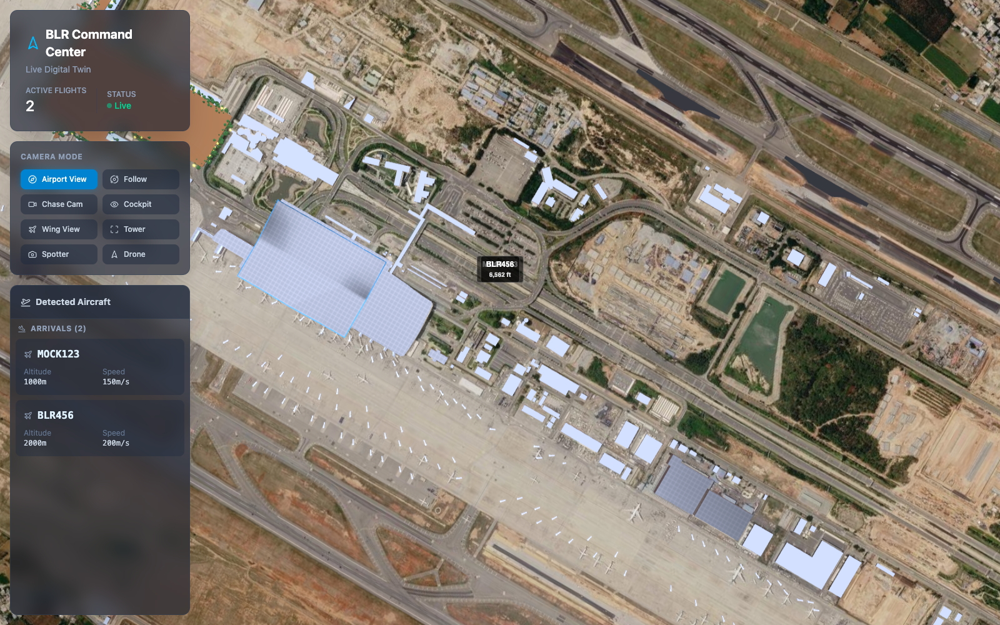
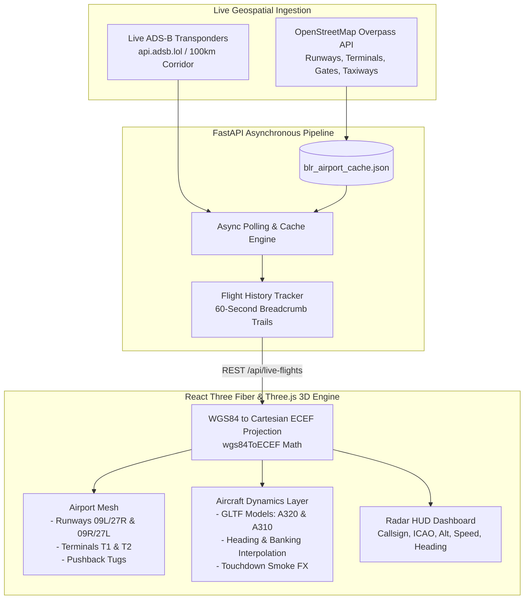

# Airport 3D Digital Twin

> Real-time 3D spatial twin and live ADS-B aviation telemetry simulator for Kempegowda International Airport (BLR / VOBL). Built with Three.js, React Three Fiber, Google 3D Tiles, and FastAPI.

<p align="center">
  
</p>

---

## The Hard Problem with Traditional Flight Tracking

Mainstream flight trackers like Flightradar24 show aircraft as flat 2D icons stamped onto generic Google Maps. But airports are intricate, three-dimensional physical ecosystems:
- Approaching flights don't move in flat lines—they intercept 3-degree glide slopes, calculate step-down altitudes, and bank into crosswind headings.
- On the ground, aircraft taxi through complex networks of aprons, rapid-exit taxiways, and gate parking positions while dodging pushback tugs and follow-me cars.
- Terminal architecture (Kempegowda's iconic garden terminals T1 & T2) creates complex spatial geometries that govern ground operations.

**Airport 3D Digital Twin** brings Bengaluru's airspace to life in true 3D spatial coordinates:
- **Live Airspace Telemetry:** Ingests live ADS-B transponder bursts via `api.adsb.lol` within a 100km radius of Bengaluru (`13.199, 77.706`).
- **Real Airport Geometries:** Queries OpenStreetMap's Overpass API for real-world runway dimensions (09L/27R and 09R/27L), taxiway networks, passenger terminals (T1 & T2), and gate positions.
- **Geodetic Math (WGS84 → ECEF):** Translates raw latitude, longitude, and barometric altitude into true 3D cartesian vectors centered on VOBL.
- **Physical Dynamics & Particle FX:** Accurate banking angles, rate-of-climb pitch, touchdown smoke particle bursts on runway contact, dynamic ground traffic, and pushback tug operations.
- **Multiple Camera POVs:** Switch between free airport orbit, locked aircraft chase-cam, and pilot cockpit view.

---

## Telemetry & Geodetic Architecture



### Mathematical Geodetic Projection (WGS84 → 3D Cartesian)
GPS transponders report latitude, longitude, and barometric altitude. To position aircraft accurately inside WebGL without distortion, the frontend applies an Earth-Centered, Earth-Fixed (ECEF) transformation:

$$
\nu = \frac{a}{\sqrt{1 - e^2 \sin^2(\phi)}}
$$
$$
X = (\nu + h) \cos(\phi) \cos(\lambda), \quad Y = (\nu + h) \cos(\phi) \sin(\lambda), \quad Z = (\nu(1 - e^2) + h) \sin(\phi)
$$

where $a = 6,378,137\text{ m}$ (semi-major axis) and $e^2 = 0.00669438$ (WGS84 eccentricity squared). This vector is then transformed into the airport's local tangent coordinate space centered on Kempegowda Airport.

---

## Tech Stack

| Layer | Technology | Description |
| :--- | :--- | :--- |
| **3D Engine** | [Three.js](https://threejs.org/) + [React Three Fiber](https://r3f.docs.pmnd.rs/) | WebGL physical rendering, scene graph & lighting |
| **3D Helpers** | [@react-three/drei](https://github.com/pmndrs/drei) | Camera controls, environment HDRIs & dynamic sky models |
| **Tiles Renderer** | [3d-tiles-renderer](https://github.com/NASA-AMMOS/3DTilesRendererJS) | Geospatial 3D tile streaming & Draco mesh decompression |
| **Frontend UI** | [React 18](https://react.dev/) + [Vite](https://vite.dev/) | Dark radar HUD interface with Lucide icons |
| **Styling** | [Tailwind CSS v4](https://tailwindcss.com/) | Tactical aviation dashboard styling |
| **Backend API** | [FastAPI](https://fastapi.tiangolo.com/) (Python 3.10+) | Asynchronous telemetry pipeline with httpx |
| **Live Telemetry** | ADS-B LOL & OpenStreetMap | Transponder broadcasts & airport infrastructure data |

---

## Repository Structure

```text
live-airport-simulator/
├── assets/                       # High-resolution media & interface previews
│   └── preview.png               # Live 3D scene & radar dashboard
├── backend/                      # Python FastAPI server
│   ├── main.py                   # OSM vector fetching & ADS-B telemetry ingestion
│   ├── requirements.txt          # FastAPI, Uvicorn, HTTPX, Pydantic
│   └── blr_airport_cache.json    # Cached OSM runway & building vectors
├── frontend/                     # React + React Three Fiber client
│   ├── public/
│   │   ├── A320.glb              # High-fidelity Airbus A320 3D model
│   │   ├── AirbusA310.glb        # Airbus A310 model
│   │   └── models/               # Textures & format assets
│   ├── src/
│   │   ├── components/
│   │   │   ├── SceneViewer.tsx   # Three.js Canvas, camera modes, tiles & lighting
│   │   │   ├── LiveFlightsLayer.tsx # Live aircraft positions & breadcrumb trails
│   │   │   ├── AirplaneMarker.tsx # Aircraft rotation, pitch & altitude kinematics
│   │   │   ├── AirportMesh.tsx   # Runways, taxiways & terminal buildings
│   │   │   ├── DynamicGroundTraffic.tsx # Apron ground vehicles & pushback tugs
│   │   │   ├── TouchdownSmoke.tsx # Particle FX on runway landing contact
│   │   │   └── Dashboard.tsx     # Flight radar list, search & camera selector
│   │   ├── api/
│   │   │   └── client.ts         # Geodetic WGS84 to cartesian ECEF projection
│   │   ├── types.ts              # Telemetry & camera mode TypeScript interfaces
│   │   └── App.tsx               # Main application container
│   ├── package.json
│   └── vite.config.ts
└── README.md
```

---

## Getting Started

### 1. Prerequisites
- **Python 3.10+**
- **Node.js 18+** and **npm**

### 2. Clone the Repository
```bash
git clone https://github.com/itsgoksz/airport-3d-digital-twin.git
cd airport-3d-digital-twin
```

### 3. Start the Backend Telemetry Server
```bash
cd backend
python3 -m venv venv
source venv/bin/activate
pip install -r requirements.txt
uvicorn main:app --reload --port 8000
```
*The backend will cache Kempegowda Airport runway geometry locally and begin streaming live ADS-B flights.*

### 4. Start the 3D Frontend
In a new terminal window:
```bash
cd frontend
npm install
npm run dev
```
Open [http://localhost:5173](http://localhost:5173) in your browser.

---

## Flight Deck & Camera Controls

- **Left Mouse Click + Drag:** Rotate / Orbit airport scene
- **Right Mouse Click + Drag:** Pan across runways and terminals
- **Scroll Wheel:** Zoom altitude in / out
- **Airport Mode:** Free exploration of terminals, taxiways, and gates
- **Follow Mode:** Click any flight from the radar HUD to lock camera focus in smooth chase mode
- **Cockpit Mode:** First-person pilot perspective on approach into Runway 09L/27R

---

<p align="center">
  Engineered by <a href="https://github.com/itsgoksz">itsgoksz</a>
</p>
