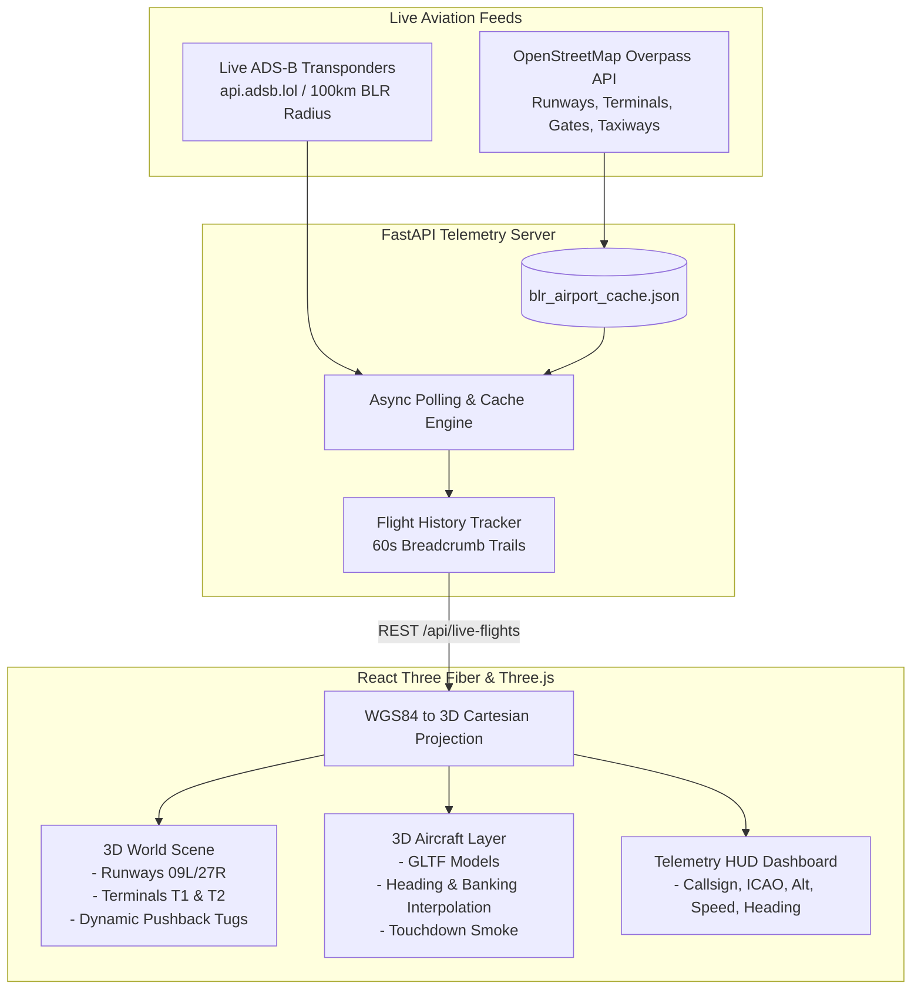

# 🛫 Airport 3D Digital Twin

> **Real-time 3D digital twin and live ADS-B aviation telemetry simulator for Kempegowda International Airport (BLR / VOBL).** Built with Three.js, React Three Fiber, and FastAPI.

<p align="center">
  
</p>

---

## Overview

Flight tracking apps usually give you flat 2D maps with static plane icons. But airports are complex, three-dimensional spatial environments—aircraft descend on glide slopes, bank into turns, taxi along intricate ground routes, and maneuver around gates.

**Airport 3D Digital Twin** recreates **Kempegowda International Airport (BLR / VOBL, Bengaluru)** in real-time 3D space:
- **Live ADS-B Telemetry:** Connects to live transponder feeds via `api.adsb.lol` within a 100km radius of Bengaluru.
- **Real Airport Topography:** Fetches real runway layouts (09L/27R, 09R/27L), taxiways, passenger terminals (T1 & T2), aprons, and gate locations from OpenStreetMap's Overpass API.
- **Geodetic Math (WGS84 -> 3D Coordinates):** Accurately translates real-world GPS coordinates (lat, lon, barometric altitude) into cartesian vectors (ECEF and local tangent plane centered on BLR).
- **Physical 3D Models & Effects:** High-detail GLTF aircraft (Airbus A320, A310) with dynamic banking, ground traffic (pushback tugs, follow-me vehicles), and touchdown smoke particle effects.
- **Multiple Camera Perspectives:** Switch between free airport orbit, locked aircraft chase-cam, and pilot cockpit view.

---

## 🕹️ Telemetry & Rendering Pipeline



---

## ✈️ Key Features

- **Live Airspace Activity:** Tracks all inbound and outbound aircraft within 100km of Kempegowda Airport, updating telemetry every 10 seconds.
- **Flight Path Breadcrumbs:** Visualizes aircraft historical tracks over the last 60 seconds with colored 3D trail lines.
- **Ground Operations & Support:** Renders airport apron gates, taxiway networks, and dynamic pushback tug vehicles moving in the gate areas.
- **Interactive Aircraft Following:** Click any flight from the telemetry HUD or in the 3D scene to lock camera focus into chase mode or cockpit view.
- **Realistic Flight Dynamics:** Calculates pitch and roll banking angles based on velocity, rate of climb/descent, and track heading changes.
- **3D Photorealistic Tiles Support:** Integrated with `3d-tiles-renderer` and `GoogleCloudAuthPlugin` for streaming Google 3D Photorealistic Tiles when configured.

---

## 🛠️ Tech Stack

| Layer | Technology | Details |
| :--- | :--- | :--- |
| **3D Engine** | [Three.js](https://threejs.org/) + [React Three Fiber](https://r3f.docs.pmnd.rs/) | WebGL physical rendering, scene graph & lighting |
| **3D Helpers** | [@react-three/drei](https://github.com/pmndrs/drei) | Camera controls, environment HDRIs, sky models |
| **Tiles Renderer** | [3d-tiles-renderer](https://github.com/NASA-AMMOS/3DTilesRendererJS) | Geospatial 3D tile streaming & Draco mesh decompression |
| **Frontend UI** | [React 18](https://react.dev/) + [Vite](https://vite.dev/) | High-performance dashboard with Lucide icons |
| **Styling** | [Tailwind CSS v4](https://tailwindcss.com/) | Dark aviation radar HUD interface |
| **Backend API** | [FastAPI](https://fastapi.tiangolo.com/) (Python 3.10+) | Asynchronous telemetry pipeline with httpx |
| **Geodata** | OpenStreetMap (Overpass) + ADS-B LOL | Live transponders and municipal airport layout |

---

## 📁 Repository Structure

```text
live-airport-simulator/
├── assets/                       # Visual preview & media
│   └── preview.png
├── backend/                      # Python FastAPI server
│   ├── main.py                   # OSM fetching, ADS-B telemetry polling & geodetics
│   ├── requirements.txt          # FastAPI, Uvicorn, HTTPX, Pydantic
│   └── blr_airport_cache.json    # Cached OSM runway & building vectors
├── frontend/                     # React + React Three Fiber client
│   ├── public/
│   │   ├── A320.glb              # Optimized Airbus A320 3D model
│   │   ├── AirbusA310.glb        # Airbus A310 model
│   │   └── models/               # Textures & alternative 3D formats
│   ├── src/
│   │   ├── components/
│   │   │   ├── SceneViewer.tsx   # Three.js Canvas, camera modes, tiles & lighting
│   │   │   ├── LiveFlightsLayer.tsx # Live aircraft instances & trajectory trails
│   │   │   ├── AirplaneMarker.tsx # Individual aircraft rotation & altitude physics
│   │   │   ├── AirportMesh.tsx   # Procedural runways, taxiways & terminals
│   │   │   ├── DynamicGroundTraffic.tsx # Ground vehicles & pushback tugs
│   │   │   ├── TouchdownSmoke.tsx # Particle FX on runway landing
│   │   │   └── Dashboard.tsx     # Flight list HUD, search & camera selector
│   │   ├── api/
│   │   │   └── client.ts         # WGS84 to cartesian ECEF math & telemetry fetcher
│   │   ├── types.ts              # Aircraft telemetry & camera mode interfaces
│   │   └── App.tsx               # Main application container
│   ├── package.json
│   └── vite.config.ts
└── README.md
```

---

## 🚀 Getting Started

### 1. Prerequisites
- **Python 3.10+**
- **Node.js 18+** and **npm** / **pnpm**

### 2. Clone the Repository
```bash
git clone https://github.com/itsgoksz/airport-3d-digital-twin.git
cd airport-3d-digital-twin
```

### 3. Start the Backend Telemetry Server
```bash
cd backend
python3 -m venv venv
source venv/bin/activate
pip install -r requirements.txt
uvicorn main:app --reload --port 8000
```
*The backend will query OSM Overpass for Kempegowda Airport geometry (caching it locally) and begin polling ADS-B telemetry.*

### 4. Start the 3D Frontend
In a new terminal window:
```bash
cd frontend
npm install
npm run dev
```
Open [http://localhost:5173](http://localhost:5173) in your browser to view the 3D digital twin.

---

## 🕹️ Controls & Camera Modes

- **Left Mouse Click + Drag:** Rotate / Orbit scene
- **Right Mouse Click + Drag:** Pan across airport
- **Scroll Wheel:** Zoom altitude in / out
- **Airport Mode:** Free navigation around terminals and runways
- **Follow Aircraft:** Click any flight from the HUD panel to smoothly attach the camera to the plane
- **Cockpit Mode:** Experience the flight deck view heading into Runway 09L/27R

---

<p align="center">
  Developed by <a href="https://github.com/itsgoksz">itsgoksz</a>
</p>
