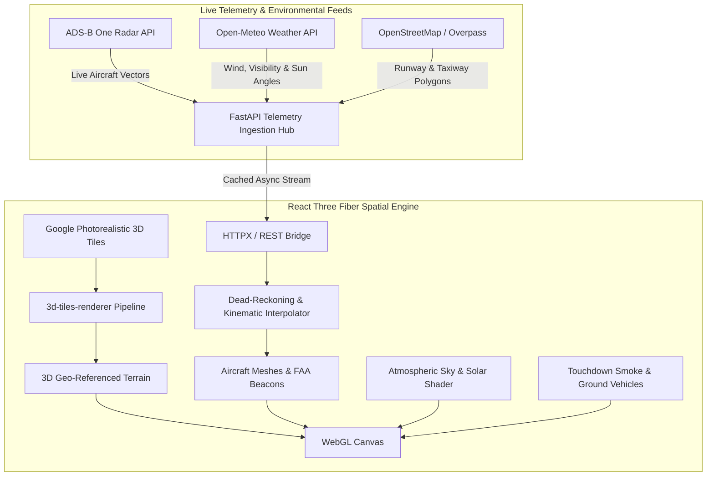

<p align="center">
  <h1 align="center">🛫 Airport 3D Digital Twin</h1>
  <p align="center">
    <strong>Real-Time 3D Digital Twin & Live ADS-B Aviation Telemetry Simulator for Kempegowda International Airport (BLR / VOBL)</strong>
  </p>
</p>

<p align="center">
  <a href="#overview">Overview</a> •
  <a href="#core-features">Features</a> •
  <a href="#aviation--rendering-architecture">Architecture</a> •
  <a href="#flight-tracking-pipeline">Telemetry Pipeline</a> •
  <a href="#tech-stack">Tech Stack</a> •
  <a href="#getting-started">Getting Started</a> •
  <a href="#performance">Performance</a> •
  <a href="#license">License</a>
</p>

<p align="center">
  
  
  
  
  
  
  
</p>

---

## 📖 Overview

The **Airport 3D Digital Twin** is a high-fidelity geospatial and aviation telemetry simulation of Kempegowda International Airport (BLR / VOBL, Bengaluru). Built on **React Three Fiber (R3F)**, **Three.js**, **Google 3D Photorealistic Tiles**, and **FastAPI**, this system renders live airspace activity within a 100km radius of Bengaluru in physical 3D space with sub-second accuracy.

By combining real-time ADS-B transponder data streams with procedural airport architecture, physical atmospheric scattering, and apron service dynamics, this digital twin demonstrates cutting-edge spatial computing applied to civil aviation management.

---

## ✨ Core Features

- **📡 Live ADS-B Transponder Radar**: Ingests live ADS-B One API telemetry, tracking commercial and cargo air traffic within a 100km radius of VOBL with smooth coordinate interpolation (climb, descent, speed, heading).
- **🌍 Photorealistic 3D Geospatial Tiles**: Streams real-world terrain and volumetric metropolitan architecture via Google 3D Photorealistic Tiles and `3d-tiles-renderer`.
- **✈️ High-Fidelity Aircraft Simulation**:
  - Detailed 3D aircraft models (**Airbus A320** & **Airbus A310**) with accurate physics rigs.
  - FAA-compliant strobes, red/green wingtip navigation lights, and nose taxi lights.
  - **Dynamic Runway Touchdown Smoke**: Real-time particle dissipation bursts triggered upon wheel-to-asphalt contact.
- **🏛️ Procedural Terminal Architecture**:
  - **Terminal 1**: Functional gates, apron stands, and procedural luminaire arrays.
  - **Terminal 2 ("Terminal in a Garden")**: Custom-modeled bamboo bell chandeliers, indoor lush botanical terracing, and iconic woven ceilings.
- **🚜 Dynamic Apron & Ground Traffic**: Autonomous pushback tugs, dynamic service vehicles, and taxiing ground routing.
- **☀️ Real-Time Solar & Weather Ephemeris**:
  - Solar elevation and azimuth calculated dynamically based on real-world UTC timestamps.
  - Synchronized with **Open-Meteo live BLR weather data** for realistic atmospheric scattering, golden hour twilights, and night operations.
- **🎥 CineCam & Free Roam Modes**: Switch effortlessly between free-roam orbit camera, tower observation deck, and cockpit chase cameras.

---

## 🏛️ Aviation & Rendering Architecture



---

## 📡 Live Telemetry Data Contract

Each aircraft in the simulation is parsed and validated into structured spatial coordinates:

```typescript
export interface AircraftTelemetry {
  hex: string;              // ICAO 24-bit transponder address
  flight: string;           // Callsign / Flight number (e.g. "IGO234")
  lat: number;              // Current latitude
  lon: number;              // Current longitude
  alt_baro: number;         // Barometric altitude (ft)
  track: number;            // Heading in degrees (0-359°)
  gs: number;               // Ground speed (knots)
  squawk: string;           // Transponder squawk code
  interpolatedPos: Vector3; // World space 3D vector coordinates
}
```

---

## 💻 Tech Stack

| Component | Technology | Rationale |
| :--- | :--- | :--- |
| **3D Rendering** | [Three.js](https://threejs.org/) · [React Three Fiber](https://r3f.docs.pmnd.rs/) | Declarative WebGL component architecture |
| **Geospatial Tiles** | [3d-tiles-renderer](https://github.com/NASA-AMMOS/3DTilesRendererJS) | Stream OGC 3D Tiles with hierarchical Level-of-Detail (LOD) |
| **3D Ecosystem** | `@react-three/drei` · `@react-three/postprocessing` | Procedural sky models, shaders, bloom, and depth-of-field |
| **Frontend UI** | React 18, TypeScript, Tailwind CSS, Lucide React | Clean heads-up flight radar telemetry HUD |
| **Backend API** | Python 3.10+, FastAPI, Uvicorn | Sub-millisecond async proxy with HTTP caching |
| **Data Providers** | ADS-B One API · Open-Meteo · Overpass API | Open aviation, solar ephemeris, and geospatial data sources |

---

## 📂 Project Structure

```text
airport-live-simulator/
├── backend/
│   ├── main.py                     # FastAPI server & telemetry aggregators
│   ├── requirements.txt            # Python dependencies
│   └── airport_data_cache_v7.json  # Cached Kempegowda layout & taxiway nodes
├── frontend/
│   ├── src/
│   │   ├── components/
│   │   │   ├── SceneViewer.tsx           # Primary R3F Canvas & lighting controller
│   │   │   ├── AirplaneMarker.tsx        # Interpolated aircraft marker & HUD
│   │   │   ├── AnimatedA320.tsx          # A320 3D mesh with beacon shader logic
│   │   │   ├── AirportMesh.tsx           # Procedural runways, taxiways, and signage
│   │   │   ├── TouchdownSmoke.tsx        # Dynamic particle burst system
│   │   │   ├── DynamicGroundTraffic.tsx  # Pushback tugs & ground vehicle simulation
│   │   │   └── PushbackTug.tsx           # Apron ground support equipment
│   │   ├── api/                          # Telemetry polling client
│   │   └── types.ts                      # Aircraft & weather data types
│   ├── public/
│   │   ├── A320.glb                      # Optimized Airbus A320 GLTF asset
│   │   └── AirbusA310.glb                # Airbus A310 asset
│   ├── package.json
│   └── vite.config.ts
└── README.md
```

---

## 🚀 Getting Started

### Prerequisites
- **Node.js**: v18.0.0 or higher
- **Python**: 3.10 or higher
- *(Optional)* A Google Maps Platform API key with **3D Tiles API** enabled.

---

### 1. Backend Setup

```bash
cd backend

# Create and activate virtual environment
python3 -m venv venv
source venv/bin/activate  # On Windows: venv\Scripts\activate

# Install dependencies
pip install -r requirements.txt

# Start backend server
uvicorn main:app --port 8000 --reload
```
API endpoints will run at **`http://localhost:8000`**.

---

### 2. Frontend Setup

```bash
cd ../frontend

# Install dependencies
npm install

# (Optional) Add your Google 3D Tiles key in .env:
# echo "VITE_GOOGLE_MAPS_API_KEY=your_key_here" > .env

# Start Vite dev server
npm run dev
```

Open **`http://localhost:5173`** to enter the 3D Kempegowda live digital twin.

---

## ⚡ Performance Optimizations

- **Hierarchical LOD Streaming**: Google 3D Tiles load asynchronously based on camera frustum distance and screen-space error metrics.
- **Instanced Mesh Ground Fleets**: Apron ground support vehicles share instanced geometry buffers, minimizing GPU draw calls.
- **Dead-Reckoning Interpolation**: Aircraft coordinate positions interpolate at 60 FPS between ADS-B polling cycles to prevent visual stuttering.

---

## 📄 License

Distributed under the **MIT License**.

<p align="center">
  Engineered with passion for aviation by <a href="https://github.com/itsgoksz">itsgoksz</a>
</p>
